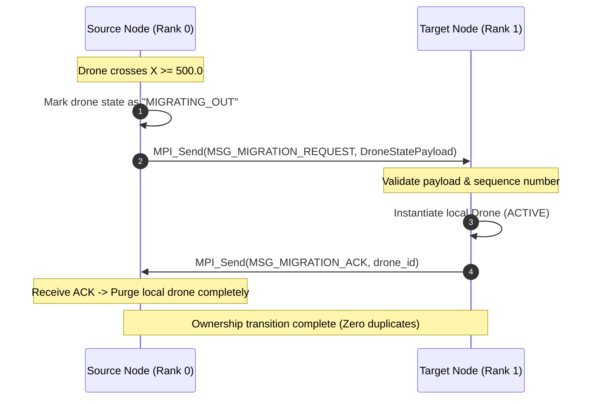

# System Architecture & Technical Specification

This document describes the design, protocols, threading models, and communication layers for the **Distributed Multi-Agent Simulation with Sensor Fusion, Agent Migration, and Fault Tolerance**.

---

## 1. Spatial Partitioning & World Geometry

The virtual simulation space is defined as a continuous 2D/3D coordinate domain:
- **Global Environment:** $X \in [0, 1000]$, $Y \in [0, 1000]$, $Z \in [0, 200]$ (meters).
- **Spatial Regions:**
  - **Node 0 (Region A):** $X \in [0.0, 500.0)$
  - **Node 1 (Region B):** $X \in [500.0, 1000.0]$
- **Migration Boundary:** $X = 500.0$
- **Buffer / Handover Margin:** $\delta = 15.0$ meters.
  - A drone moving from Region A towards Region B enters the handover zone when $X \ge 500.0$.
  - Hysteresis avoids rapid ping-pong migrations at the exact boundary.

```
+------------------------------------+------------------------------------+
|                                    |                                    |
|             Region A               |             Region B               |
|            (MPI Rank 0)            |            (MPI Rank 1)            |
|                                    |                                    |
|   ~500 Drones                      |   ~500 Drones                      |
|                                    |                                    |
|                              Boundary                              |
|                              X = 500.0                             |
|                                 |                                  |
|                          [485.0 | 515.0]                           |
|                         <-- Handoff Zone -->                       |
+------------------------------------+------------------------------------+
```

---

## 2. Hybrid Execution & Threading Model

### 2.1 Intra-Node Parallelism (OpenMP)
Each node executes hundreds of agents locally. OpenMP parallelizes compute-intensive tasks:
- **Kinematics & Physics Update:** Updating positions, velocities, collision checks, battery drain:
  ```cpp
  #pragma omp parallel for schedule(static)
  for (size_t i = 0; i < local_drones.size(); ++i) {
      local_drones[i].update_step(dt);
  }
  ```
- **Sensory Field-of-View Computations:** Calculating raycasts/ranges to detected target objects:
  ```cpp
  #pragma omp parallel for schedule(dynamic, 16)
  for (size_t i = 0; i < local_drones.size(); ++i) {
      local_drones[i].scan_sensors(world_targets);
  }
  ```
- **Local Decision Logic:** Waypoint selection, obstacle avoidance, mission updates.

### 2.2 Inter-Node Distribution (MPI)
MPI handles synchronization, event streaming, and agent transfer:
- **Non-blocking Communication (`MPI_Isend`, `MPI_Irecv`):** Avoids blocking the local simulation loop while waiting on remote nodes.
- **Batched Communication Window:** Synchronous barrier is avoided on every sub-tick. Communication occurs periodically (e.g., every 50ms / every simulation tick) for high throughput.

---

## 3. Dynamic Agent Migration Protocol

To guarantee **Distribution-Invariance** (as studied by Paciorek & Turek [1]) and prevent duplicate or vanished agents:



### Safety Guarantees:
1. **At-most-one active owner:** When state is in `MIGRATING_OUT`, it cannot accept new local tasks or modify persistent state.
2. **Timeout / Rollback:** If ACK is not received within timeout $T_{\text{mig\_timeout}}$, Node A checks Fault Manager status.

---

## 4. Decentralized Sensor Fusion

Multiple drones across different regions can observe the same dynamic target (e.g., simulated ground vehicles or intruder objects):

### 4.1 Observation Model
Each observation consists of:
- `target_id`: Unique identifier of the observed target.
- `observer_drone_id`: ID of the drone sensing the object.
- `timestamp`: Simulation step / epoch time.
- `position_estimate`: Vector3 estimated coordinate.
- `confidence`: Confidence score $\in [0.0, 1.0]$ based on distance and sensor noise.

### 4.2 Fusion Algorithm
When node receives an observation from remote rank:
$$\hat{P}_{\text{fused}} = \frac{w_1 P_1 + w_2 P_2}{w_1 + w_2}, \quad w_i = \text{confidence}_i \cdot e^{-\lambda (t_{\text{now}} - t_i)}$$
This produces a smooth, shared global situational track list without a centralized master server.

---

## 5. Distributed Task Allocation (Auction / Consensus)

1. **Mission Generation:** Missions (Reconnaissance, Inspection, Target Tracking) arise dynamically.
2. **Task Announcement:** Node broadcasts `MSG_TASK_ANNOUNCE` with mission requirements and location.
3. **Local Bid Calculation:** Each available drone evaluates utility:
   $$\text{Utility} = \alpha \cdot \frac{1}{\text{dist}(\text{drone}, \text{target})} + \beta \cdot \text{Battery} - \gamma \cdot \text{CurrentWorkload}$$
4. **Lightweight Consensus:** Highest bidder across both nodes claims the mission via `MSG_TASK_CLAIM`. Conflicts are resolved deterministically using node rank and timestamp priority.

---

## 6. Fault Tolerance & Recovery Model

### 6.1 Failure Detection
- Periodic Heartbeats (`MSG_HEARTBEAT`) exchanged every $T_{\text{hb}} = 100\text{ ms}$.
- If no heartbeat is received for $3 \times T_{\text{hb}}$, node transition into `SUSPECTED_FAILURE`.

### 6.2 Partition & Reconnection
- **During Partition:** Each node runs in standalone autonomous mode within its own spatial boundaries.
- **Reconnection Reconciliation:** Reconnect handshake exchanges highest event sequence numbers and merges diverged world states.

### 6.3 State Checkpointing
- Every $K$ steps, critical global state (active tasks, persistent target tracks) is checkpointed locally and replicated asynchronously.

---

## 7. Telemetry & Visualization Bridge

The simulation engine is completely decoupled from rendering:
- Runs headless C++ backend at high tick rates (e.g., 60 Hz).
- Embedded lightweight TCP/WebSocket server broadcasts binary/JSON frame buffers to external renderers (Unity 3D / Web viewer):
  ```json
  {
    "step": 1420,
    "rank": 0,
    "active_drones": 512,
    "drones": [
      {"id": 12, "pos": [450.2, 120.4, 30.0], "vel": [5.1, 0.0, 0.0], "battery": 88.5, "state": "PATROL"}
    ]
  }
  ```
