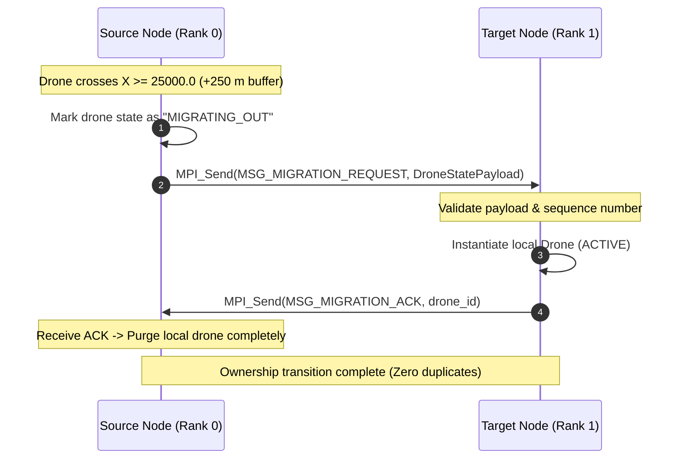

# System Architecture & Technical Specification

This document describes the design, protocols, threading models, and communication layers for the **Distributed Multi-Agent Simulation with Sensor Fusion, Agent Migration, and Fault Tolerance**.

---

## 🛠 Технологический стек проекта

```
+-----------------------------------------------------------------------------------+
| 1. C++20        | Чистая логика дронов, физика, сенсоры и миссии                  |
| 2. OpenMP       | #pragma omp parallel for — параллелим расчеты роя по ядрам ПК   |
| 3. OpenMPI      | Связь между нодами: передача дронов при миграции и синхронизация|
| 4. CMake        | Сборка всего проекта одной командой (make / ninja)              |
| 5. TCP/Sockets  | Легковесный стриминг кадров (JSON/координаты) из C++ наружу    |
| 6. Visualizer   | Экран: граница X=25000 м (25 км/сектор), 6 зумов (25–150%), живая миграция роя |
+-----------------------------------------------------------------------------------+
```

---

## 1. Spatial Partitioning & World Geometry

The virtual simulation space is defined as a continuous 2D/3D coordinate domain scaled to realistic UAV operations (**25 km × 25 km per sector**):
- **Global Environment:** $X \in [0, 50000]$, $Y \in [0, 25000]$, $Z \in [0, 500]$ (meters).
- **Spatial Regions:**
  - **Node 0 (Region A):** $X \in [0.0, 25000.0)$ — `25 km × 25 km`
  - **Node 1 (Region B):** $X \in [25000.0, 50000.0]$ — `25 km × 25 km`
- **Drone Density:** `500` drones per sector (2 drones per 100 m of sector side, `1000` drones total).
- **Migration Boundary:** $X = 25000.0\text{ m}$
- **Buffer / Handover Margin:** $\delta = 250.0\text{ m}$ (handoff zone `[24750.0, 25250.0]`).
  - A drone moving from Region A towards Region B migrates when $X \ge 25000.0 + \delta$ (and back when $X < 25000.0 - \delta$).
  - Hysteresis avoids rapid ping-pong migrations at the exact boundary.
- **Scale-Matched Engagement Parameters:** Drone speed `80–100 m/s` (or `time_scale = 5x`), radar range `1200 m`, close inspection `30–40 m`, drone firing range `150 m`, hostile threat radius `200 m`.

```
+------------------------------------+------------------------------------+
|                                    |                                    |
|        Region A (25 × 25 km)       |        Region B (25 × 25 km)       |
|            (MPI Rank 0)            |            (MPI Rank 1)            |
|                                    |                                    |
|   ~500 Drones                      |   ~500 Drones                      |
|                                    |                                    |
|                              Boundary                              |
|                            X = 25000 m                             |
|                                 |                                  |
|                        [24750 | 25250] m                           |
|                         <-- Handoff Zone -->                       |
+------------------------------------+------------------------------------+
```

---

## 2. Hybrid Execution & Threading Model

### 2.1 Intra-Node Parallelism (OpenMP)
Each node executes hundreds of agents locally. OpenMP parallelizes compute-intensive tasks:
- **Kinematics & Physics Update:** Updating positions, velocities, collision checks, battery drain:
  ```cpp
  #pragma omp parallel for schedule(static)
  for (size_t i = 0; i < local_drones.size(); ++i) {
      local_drones[i].update_step(dt);
  }
  ```
- **Sensory Field-of-View Computations:** Calculating raycasts/ranges to detected target objects:
  ```cpp
  #pragma omp parallel for schedule(dynamic, 16)
  for (size_t i = 0; i < local_drones.size(); ++i) {
      local_drones[i].scan_sensors(world_targets);
  }
  ```
- **Local Decision Logic:** Waypoint selection, obstacle avoidance, mission updates.

### 2.2 Inter-Node Distribution (MPI)
MPI handles synchronization, event streaming, and agent transfer:
- **Non-blocking Communication (`MPI_Isend`, `MPI_Irecv`):** Avoids blocking the local simulation loop while waiting on remote nodes.
- **Batched Communication Window:** Synchronous barrier is avoided on every sub-tick. Communication occurs periodically (e.g., every 50ms / every simulation tick) for high throughput.

---

## 3. Dynamic Agent Migration Protocol

To guarantee **Distribution-Invariance** (as studied by Paciorek & Turek [1]) and prevent duplicate or vanished agents:



### Safety Guarantees:
1. **At-most-one active owner:** When state is in `MIGRATING_OUT`, it cannot accept new local tasks or modify persistent state.
2. **Timeout / Rollback:** If ACK is not received within timeout $T_{\text{mig\_timeout}}$, Node A checks Fault Manager status.

---

## 4. Decentralized Sensor Fusion

Multiple drones across different regions can observe the same dynamic target (e.g., simulated ground vehicles or intruder objects):

### 4.1 Observation Model
Each observation consists of:
- `target_id`: Unique identifier of the observed target.
- `observer_drone_id`: ID of the drone sensing the object.
- `timestamp`: Simulation step / epoch time.
- `position_estimate`: Vector3 estimated coordinate.
- `confidence`: Confidence score $\in [0.0, 1.0]$ based on distance and sensor noise.

### 4.2 Fusion Algorithm
When node receives an observation from remote rank:
$$\hat{P}_{\text{fused}} = \frac{w_1 P_1 + w_2 P_2}{w_1 + w_2}, \quad w_i = \text{confidence}_i \cdot e^{-\lambda (t_{\text{now}} - t_i)}$$
This produces a smooth, shared global situational track list without a centralized master server.

---

## 5. Distributed Task Allocation (3-Mode Auction / Consensus) & Drone FSM

1. **Three Mission Modes (POD-safe for MPI):**
   - **`RECONNAISSANCE`**: carries fixed array `Vector3 waypoints[3]` + `waypoint_count` (`1` = point check, `2..3` = area search). Completes once all waypoints are visited or a new object is detected.
   - **`OBJECT_INSPECTION`**: close approach (`30–40 m`) to minimize Gaussian noise and classify target (`is_hostile` vs non-hostile).
   - **`TARGET_ELIMINATION`**: sole combat mode; uniform drone damage (`50 HP`/hit, 2 hits = target eliminated, `fire_cooldown = 1.5 s`) with a **10% deterministic miss probability** (seeded via `make_deterministic_seed(drone_id, step, salt)` so OpenMP Thread-Invariance is preserved), synchronized across nodes via `TAG_COMBAT_EVENT`.
2. **Dynamic Force-Ratio Analysis & Smart Reinforcements (Any Group Size $N \ge 1$):**
   - Instead of a fixed enemy-count threshold, every hostile encounter (even 1–2 enemies) evaluates actual combat strength:
     $$\text{RequiredPower} = 1.5 \cdot \sum_{e \in \text{cluster}} \frac{\text{HP}_e}{100}, \quad \text{FriendlyPower} = \sum_{\substack{d \in \text{nearby} \\ \text{HP}_d \ge 40}} \frac{\text{HP}_d}{100}, \quad \text{deficit} = \max\left(0,\; \lceil \text{RequiredPower} - \text{FriendlyPower} \rceil\right)$$
   - The `1.5×` safety margin accounts for the 10% miss probability and enemy return fire (e.g., 1 drone vs 2 enemies immediately requests +2 drones; 1 wounded 50 HP drone vs 1 enemy requests +1 drone; 1 healthy drone vs 1 wounded 50 HP enemy handles it solo).
   - **Two-tier escalation:** if `deficit > 0`, the node first dispatches available local drones (preserving a `20%` sector defense reserve), and broadcasts any remaining `remote_deficit` via `MSG_TASK_ANNOUNCE` (`required_drones = remote_deficit`) over MPI so the peer sector sends reinforcements that migrate across `X = 25000 m`. Re-evaluated dynamically if drones drop into `EVADE` or `FAILED`.
3. **Dynamic Mode Switching (FSM):** Drones autonomously transition between `PATROL`, `RECONNAISSANCE`, `OBJECT_INSPECTION`, `TARGET_ELIMINATION`, `EVADE` (triggered on `threat_level >= 0.7` & `hp < 40`), `MIGRATING_OUT`, and `FAILED` (`hp <= 0` or `battery <= 0`).
4. **Task Announcement:** Node broadcasts `MSG_TASK_ANNOUNCE` with mission type, waypoints, `required_drones`, and priority.
5. **Eligibility Guard & Local Bid Calculation:**
   - Combat missions (`TARGET_ELIMINATION`) filter out damaged/low-battery drones (`hp < 40` or `battery < 20%`).
   - Each eligible `PATROL` drone evaluates mode-weighted utility:
     $$\text{Utility} = \alpha \cdot \frac{100}{\max(10,\; \text{dist})} + \beta \cdot \frac{\text{HP}}{100} + \gamma \cdot \frac{\text{Battery}}{100} - \delta \cdot \text{Threat} - \eta \cdot \text{Workload}$$
6. **Lightweight Consensus:** Highest bidder(s) across both nodes claim the mission via `MSG_TASK_CLAIM`. Conflicts are resolved deterministically using node rank and drone ID priority.

---

## 6. Fault Tolerance & Recovery Model

### 6.1 Failure Detection
- Periodic Heartbeats (`MSG_HEARTBEAT`) exchanged every $T_{\text{hb}} = 100\text{ ms}$.
- If no heartbeat is received for $3 \times T_{\text{hb}}$, node transition into `SUSPECTED_FAILURE`.

### 6.2 Partition & Reconnection
- **During Partition:** Each node runs in standalone autonomous mode within its own spatial boundaries.
- **Reconnection Reconciliation:** Reconnect handshake exchanges highest event sequence numbers and merges diverged world states.

### 6.3 State Checkpointing
- Every $K$ steps, critical global state (active tasks, persistent target tracks) is checkpointed locally and replicated asynchronously.

---

## 7. Telemetry & Multi-Zoom Visualization Bridge

The simulation engine is completely decoupled from rendering:
- Runs headless C++ backend at high tick rates (`20 Hz` / `60 Hz`), never blocking on visualization clients.
- Embedded lightweight TCP/WebSocket server broadcasts throttled (`10–20 FPS`), NaN-safe JSON state snapshots to external renderers (HTML5 Canvas / Unity 3D):
  ```json
  {
    "step": 1420,
    "checkpoint_step": 1400,
    "rank": 0,
    "active_drones": 500,
    "drones": [
      {"id": 12, "pos": [24500.2, 12040.4, 80.0], "hp": 90.0, "battery": 88.5, "threat": 0.4, "state": "TARGET_ELIMINATION", "firing_at": 1}
    ]
  }
  ```
- **6 Non-Linear Zoom Levels with LOD & Viewport Culling** (only in-view entities are rendered):
  - `25%` (`50 km` / full `25 km` sector) — points & border only
  - `50%` (`10 km`) — groups, migration lines, threat zones
  - `75%` (`4 km`) — directional icons, `RECONNAISSANCE` waypoint paths
  - `100%` (`2 000 m`) — HP bars, threat/`EVADE` halos, firing lines
  - `125%` (`500 m`) — drone IDs, exact HP values, `Sensor Fusion` estimates
  - `150%` (`100 m`) — macro view of `30–40 m` `OBJECT_INSPECTION` & velocity vectors
